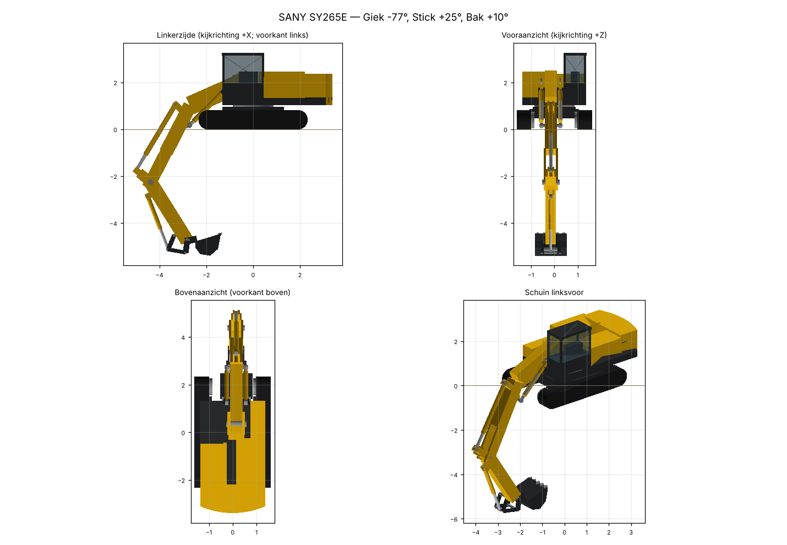
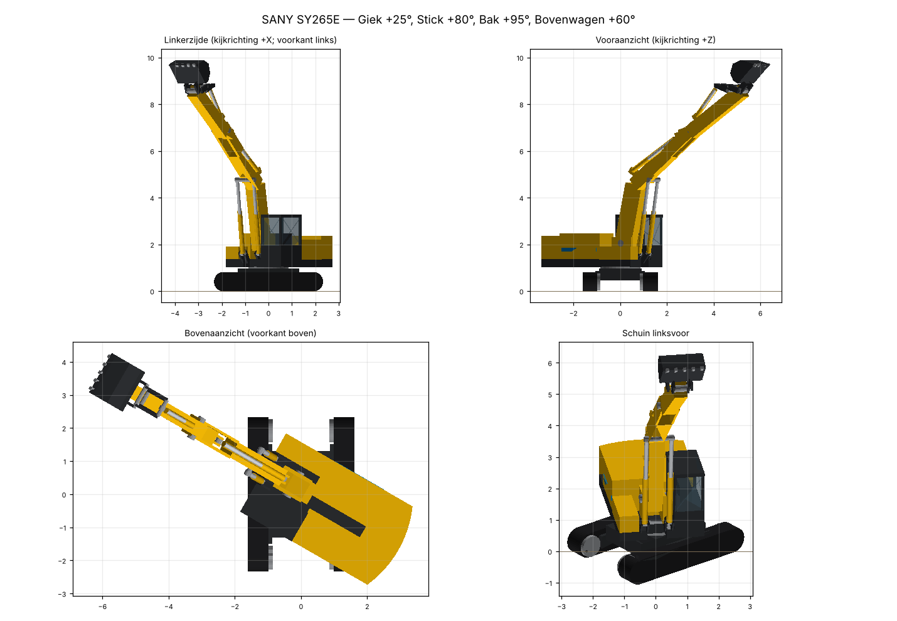
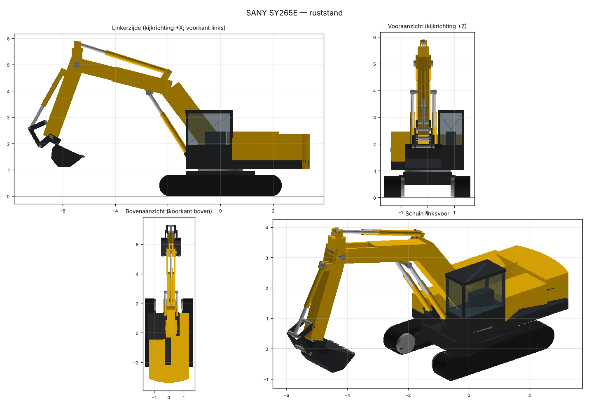

# Rapport EX_SY265E: SANY SY265E

- Machinetype: graafmachine  |  detailniveau: volledig  |  rig: Graafmachine  |  categorie: Graafmachines
- Bron: —  |  licentie: Eigen werk: procedureel gegenereerd uit openbare datasheetmaten; vrij te gebruiken en herdistribueren. Bevat geen merklogo's of fabrikantgeometrie.  |  formaat: GLB (procedureel, m, Y-up)
- Afmetingen (m): lengte 10.683, breedte 3.190, hoogte 5.888  (bbox [-1.595, 0.0, -7.303] … [1.595, 5.888, 3.38], ruststand)
- Polygonen: 3444
- Bibliotheek-CSV: `EX_SY265E/model.glb;0;1;Graafmachine`


## Voorbeeld





## Controle

| Groep | Status | Bevinding |
|---|---|---|
| manifest | OK | alle sjabloonsleutels aanwezig |
| manifest | OK | bibliotheek_csv: EX_SY265E/model.glb;0;1;Graafmachine |
| hiërarchie | OK | 24 nodes, parent-child gelijk aan manifest |
| hiërarchie | OK | rigketen Bovenwagen → Giek |
| hiërarchie | OK | rigketen Giek → Stick |
| hiërarchie | OK | rigketen Stick → Bak |
| bevroren | OK | alle nodes schaal 1; rotatie alleen op gerichte cilinderhelften |
| namen | OK | alle namen uniek |
| namen | OK | rignaam Bovenwagen aanwezig |
| namen | OK | rignaam Giek aanwezig |
| namen | OK | rignaam Stick aanwezig |
| namen | OK | rignaam Bak aanwezig |
| afmetingen | OK | bbox breedte(X) 3.190 × hoogte(Y) 5.888 × lengte(Z) 10.683 m |
| afmetingen | OK | manifest-afmetingen wijken max 0.000 m af |
| afmetingen | OK | breedte_m model 3.190 m, datasheet 3.190 m (+0.0%) |
| nulpunt | OK | grond van EX_SY265E_Onderwagen: Y = 0.0000 m |
| nulpunt | OK | midden EX_SY265E_Onderwagen op X,Z = [0.0, 0.0] |
| voorkant | OK | voorkant -Z (afgeleid van Giek); conventie -Z |
| referentie | OK | voorkant -Z gelijk aan A40G.glb |
| referentie | OK | voorkant -Z gelijk aan Cat336E_LongReach.glb |
| referentie | OK | opbouw t.o.v. Cat336E_LongReach.glb: 18 gedeelde nodes hangen onder dezelfde parent |
| polygonen | OK | 3444 driehoeken (doel ≤ 50000) |
| normalen | OK | alle primitieven hebben eenheidsnormalen, consistent met de winding |
| faces | OK | alle meshes gesloten (geen open randen) |
| texturen | OK | geen texturen gebruikt |
| pivot | OK | Kettingwiel_L: draaipunt [-0.925, 0.402, 1.916] (= manifest, op de eigen geometrie) |
| pivot | OK | Leiwiel_L: draaipunt [-0.925, 0.402, -1.916] (= manifest, op de eigen geometrie) |
| pivot | OK | Kettingwiel_R: draaipunt [0.925, 0.402, 1.916] (= manifest, op de eigen geometrie) |
| pivot | OK | Leiwiel_R: draaipunt [0.925, 0.402, -1.916] (= manifest, op de eigen geometrie) |
| pivot | OK | Bovenwagen: draaipunt [0.0, 0.0, 0.0] (= manifest, op de eigen geometrie) |
| pivot | OK | Giek: draaipunt [0.15, 2.05, -0.35] (= manifest, op de eigen geometrie) |
| pivot | OK | Stick: draaipunt [0.15, 5.0, -5.46] (= manifest, op de eigen geometrie) |
| pivot | OK | Bak: draaipunt [0.15, 2.228, -6.468] (= manifest, op de eigen geometrie) |
| extras | OK | Kettingwiel_L: stralen aanwezig |
| extras | OK | Leiwiel_L: stralen aanwezig |
| extras | OK | Kettingwiel_R: stralen aanwezig |
| extras | OK | Leiwiel_R: stralen aanwezig |
| extras | OK | 8 joints met draaias/min_hoek_graden/max_hoek_graden in node-extras = manifest |
| cilinders | OK | Giekcilinder_L: richt op elkaars pen, penafstand 2.743 m, slag via Giek binnen min..max |
| cilinders | OK | Giekcilinder_R: richt op elkaars pen, penafstand 2.743 m, slag via Giek binnen min..max |
| cilinders | OK | Stickcilinder: richt op elkaars pen, penafstand 3.612 m, slag via Stick binnen min..max |
| cilinders | OK | Bakcilinder: richt op elkaars pen, penafstand 2.480 m, slag via Bak binnen min..max |
| joint-test | OK | 20 node-paren raken elkaar in ruststand (pennen, bokken, cilinders); doorsnijding = nieuw contact > 1 cm of bestaand contact > 5 cm dieper |
| joint-test | OK | Kettingwiel_L: geen nieuwe doorsnijding op min -180 / max 180; positief = n.v.t. (wiel) |
| joint-test | OK | Leiwiel_L: geen nieuwe doorsnijding op min -180 / max 180; positief = n.v.t. (wiel) |
| joint-test | OK | Kettingwiel_R: geen nieuwe doorsnijding op min -180 / max 180; positief = n.v.t. (wiel) |
| joint-test | OK | Leiwiel_R: geen nieuwe doorsnijding op min -180 / max 180; positief = n.v.t. (wiel) |
| joint-test | OK | Bovenwagen: geen nieuwe doorsnijding op min -180 / max 180; positief = links |
| joint-test | OK | Giek: geen nieuwe doorsnijding op min -77.0 / max 25.0; positief = heffen |
| joint-test | OK | Stick: geen nieuwe doorsnijding op min -55 / max 80; positief = heffen |
| joint-test | OK | Bak: geen nieuwe doorsnijding op min -50 / max 95; positief = bak openen (lossen) |
| joint-test | OK | geen vervorming mogelijk: alle nodes rigide (schaal 1, geen skinning) |
| werkbereik | OK | max_graafdiepte_m: model 6.71 m, datasheet 6.71 m (+0.1%) |
| werkbereik | OK | max_graafhoogte_m: model 9.75 m, datasheet 9.74 m (+0.0%) |
| werkbereik | OK | max_reikwijdte_grond_m: model 10.26 m, datasheet 10.22 m (+0.3%) |
| animatie | OK | test_animatie.glb: per joint 0 → min → max → 0, cilinders mee gericht, bakkoppeling opgelost (32 s) |

## Werkbereik t.o.v. datasheet

| Grootheid | Model (m) | Datasheet (m) | Afwijking |
|---|---|---|---|
| max_graafdiepte_m | 6.715 | 6.705 | +0.1% |
| max_graafhoogte_m | 9.747 | 9.745 | +0.0% |
| max_reikwijdte_grond_m | 10.26 | 10.225 | +0.3% |

## Hiërarchie

```
- EX_SY265E  (oorsprong [0.0, 0.0, 0.0])
  - EX_SY265E_Onderwagen  (oorsprong [0.0, 0.0, 0.0])
    - EX_SY265E_Rups_L  (oorsprong [0.0, 0.0, 0.0])
    - Kettingwiel_L  (oorsprong [-0.925, 0.402, 1.916])  [-180..180°] lokaal X (Godot: X); positieve hoek = machine rijdt achteruit
    - Leiwiel_L  (oorsprong [-0.925, 0.402, -1.916])  [-180..180°] lokaal X (Godot: X); positieve hoek = machine rijdt achteruit
    - EX_SY265E_Rups_R  (oorsprong [0.0, 0.0, 0.0])
    - Kettingwiel_R  (oorsprong [0.925, 0.402, 1.916])  [-180..180°] lokaal X (Godot: X); positieve hoek = machine rijdt achteruit
    - Leiwiel_R  (oorsprong [0.925, 0.402, -1.916])  [-180..180°] lokaal X (Godot: X); positieve hoek = machine rijdt achteruit
  - Bovenwagen  (oorsprong [0.0, 0.0, 0.0])  [-180..180°] lokaal Z (Godot: Y); positieve hoek = naar links
    - EX_SY265E_Cabine  (oorsprong [0.0, 0.0, 0.0])
    - EX_SY265E_Cabine_Glas  (oorsprong [0.0, 0.0, 0.0])
    - Giek  (oorsprong [0.15, 2.05, -0.35])  [-77.0..25.0°] lokaal X (Godot: X); positieve hoek = heffen
      - Stick  (oorsprong [0.15, 5.0, -5.46])  [-55..80°] lokaal X (Godot: X); positieve hoek = stick uit (van de machine af)
        - Bak  (oorsprong [0.15, 2.228, -6.468])  [-50..95°] lokaal X (Godot: X); positieve hoek = bak openen (lossen)
        - Tuimelaar  (oorsprong [0.15, 2.818, -6.626])
          - Bakstang  (oorsprong [0.15, 2.558, -7.222])
          - Bakcilinder_Stang  (oorsprong [0.15, 2.558, -7.222])  [pen 1.7019..2.6339 m]
        - Stickcilinder_Stang  (oorsprong [0.15, 5.8, -5.432])  [pen 2.7098..4.1826 m]
        - Bakcilinder_Huis  (oorsprong [0.15, 4.721, -6.008])  [pen 1.7019..2.6339 m]
      - Giekcilinder_L_Stang  (oorsprong [-0.25, 3.93, -2.728])  [pen 2.0346..3.173 m]
      - Giekcilinder_R_Stang  (oorsprong [0.55, 3.93, -2.728])  [pen 2.0346..3.173 m]
      - Stickcilinder_Huis  (oorsprong [0.15, 4.715, -1.987])  [pen 2.7098..4.1826 m]
    - Giekcilinder_L_Huis  (oorsprong [-0.25, 1.62, -1.25])  [pen 2.0346..3.173 m]
    - Giekcilinder_R_Huis  (oorsprong [0.55, 1.62, -1.25])  [pen 2.0346..3.173 m]
```

## Joints: begin- en eindstand

| Joint | As | As glTF | Positief (gemeten) | Min | Zwaartepunt bij min | Max | Zwaartepunt bij max | Doorsnijding |
|---|---|---|---|---|---|---|---|---|
| Kettingwiel_L | X | [1, 0, 0] | n.v.t. (wiel) | -180° | [-0.925, 0.403, 1.917] | 180° | [-0.925, 0.403, 1.917] | geen |
| Leiwiel_L | X | [1, 0, 0] | n.v.t. (wiel) | -180° | [-0.925, 0.403, -1.916] | 180° | [-0.925, 0.403, -1.916] | geen |
| Kettingwiel_R | X | [1, 0, 0] | n.v.t. (wiel) | -180° | [0.925, 0.403, 1.917] | 180° | [0.925, 0.403, 1.917] | geen |
| Leiwiel_R | X | [1, 0, 0] | n.v.t. (wiel) | -180° | [0.925, 0.403, -1.916] | 180° | [0.925, 0.403, -1.916] | geen |
| Bovenwagen | Z | [0, 1, 0] | links | -180° | [-0.095, 3.088, 3.302] | 180° | [-0.095, 3.088, 3.302] | geen |
| Giek | X | [1, 0, 0] | heffen | -77.0° | [0.15, -1.875, -2.95] | 25.0° | [0.15, 5.401, -3.671] | geen |
| Stick | X | [1, 0, 0] | heffen | -55° | [0.15, 3.568, -4.613] | 80° | [0.15, 5.436, -6.975] | geen |
| Bak | X | [1, 0, 0] | bak openen (lossen) | -50° | [0.15, 2.374, -5.826] | 95° | [0.15, 1.74, -6.911] | geen |

Testanimatie: `test_animatie.glb` (animatie `Jointtest`, cilinders mee gericht).

## Datasheetwaarden

| Waarde | | Bron |
|---|---|---|
| breedte_m | 3.19 | SANY-flyer SY265E (2025-12-10) via machinepartner.no; Veenma 3,19 m; DNL 3,22 m |
| rupslengte_m | 4.638 | SANY-flyer SY265E / DNL (totale lengte onderwagen 4.638 mm) |
| rupscontactlengte_m | 3.833 | SANY-flyer SY265E |
| spoorbreedte_m | 2.59 | SANY-flyer SY265E en DNL |
| rupsplaat_m | 0.6 | SANY-flyer SY265E en Veenma (standaard 600 mm; DNL noemt 900 mm) |
| bovenwagenbreedte_m | 2.71 | Veenma |
| staartdraaistraal_m | 3.38 | SANY-flyer SY265E (Veenma noemt 3.105 mm, DNL 3.800 mm) |
| contragewicht_vrije_hoogte_m | 1.045 | SANY UK SY265C (zelfde onderwagen; niet gepubliceerd voor de E) |
| bodemvrijheid_m | 0.47 | SANY UK SY265C (niet gepubliceerd voor de E) |
| hoogte_boven_cabine_m | 3.255 | DNL / Veenma |
| transportlengte_m | 10.565 | SANY-flyer SY265E en DNL (Veenma 10.290 mm) |
| transporthoogte_m | 3.51 | SANY-flyer SY265E (giek in transportstand) |
| max_graafdiepte_m | 6.705 | DNL en Veenma |
| max_graafhoogte_m | 9.745 | SANY-flyer SY265E / DNL (Veenma 9.815 mm) |
| max_reikwijdte_grond_m | 10.225 | DNL en Veenma |
| gieklengte_m | 5.9 | SANY UK SY265C; zelfde werkbereik als de E, dus aangenomen gelijk |
| steellengte_m | 2.95 | SANY UK SY265C; aangenomen gelijk |
| bakinhoud_m3 | 1.35 | SANY-flyer SY265E (1,35/1,55 m³) |
| bedrijfsgewicht_kg | 28100 | SANY-flyer SY265E / DNL (andere dealers 26.500-28.000 kg) |
| batterij_kwh | 600 | DNL e.a. (Veenma noemt 422 kWh LFP) |

## Polygonen per node

| Node | Driehoeken |
|---|---|
| EX_SY265E_Onderwagen | 152 |
| EX_SY265E_Rups_L | 176 |
| Kettingwiel_L | 84 |
| Leiwiel_L | 124 |
| EX_SY265E_Rups_R | 176 |
| Kettingwiel_R | 84 |
| Leiwiel_R | 124 |
| Bovenwagen | 420 |
| EX_SY265E_Cabine | 84 |
| EX_SY265E_Cabine_Glas | 12 |
| Giek | 276 |
| Stick | 264 |
| Bak | 204 |
| Tuimelaar | 152 |
| Bakstang | 88 |
| Giekcilinder_L_Huis | 128 |
| Giekcilinder_L_Stang | 128 |
| Giekcilinder_R_Huis | 128 |
| Giekcilinder_R_Stang | 128 |
| Stickcilinder_Huis | 128 |
| Stickcilinder_Stang | 128 |
| Bakcilinder_Huis | 128 |
| Bakcilinder_Stang | 128 |

## Vergelijking met referentie

| Bestand | Afm X×Y×Z (m) | Min | Max | Voorkant | Wortel |
|---|---|---|---|---|---|
| A40G.glb | [3.59, 4.196, 11.406] | [-1.795, -0.015, -4.52] | [1.795, 4.181, 6.886] | -Z (Voorwagen) | ['A40G'] |
| Cat336E_LongReach.glb | [4.08, 8.745, 19.112] | [-2.04, -0.008, -15.526] | [2.04, 8.737, 3.586] | -Z (Giek) | ['Cat336E'] |

## Afwijkingen van de conventie

- rig-onderdelen zonder voorvoegsel [TYPE]_[MODEL]_ (exacte 4DVis-namen voor rig Graafmachine): Kettingwiel_L, Leiwiel_L, Kettingwiel_R, Leiwiel_R, Bovenwagen, Giek, Stick, Bak, Tuimelaar, Bakstang, Giekcilinder_L_Huis, Giekcilinder_L_Stang, Giekcilinder_R_Huis, Giekcilinder_R_Stang, Stickcilinder_Huis, Stickcilinder_Stang, Bakcilinder_Huis, Bakcilinder_Stang
- spiegeling: glTF is rechtshandig, Unreal linkshandig; de importer spiegelt één as. Niet in het model gecorrigeerd

## Aannames

- joint-assen in Blender-notatie zoals extras.draaias in de referentie (X = dwars, Z = verticaal); positief = heffen/uit/open (X) en naar links (Z)
- joint Kettingwiel_L: limieten geschat (-180..180)
- joint Leiwiel_L: limieten geschat (-180..180)
- joint Kettingwiel_R: limieten geschat (-180..180)
- joint Leiwiel_R: limieten geschat (-180..180)
- joint Bovenwagen: limieten geschat (-180..180)
- joint Giek: limieten geschat (-77.0..25.0)
- joint Stick: limieten geschat (-55..80)
- joint Bak: limieten geschat (-50..95)
- Vereenvoudigd model (optie C): maten uit de datasheet, vormen schematisch; geen fabrikantgeometrie
- Giek 5,9 m en steel 2,95 m van de SY265C overgenomen: het werkbereik van de E is gelijk aan dat van de C
- Werkhoeken giek -47.0..55.0° absoluut, steel [-155, -20]° en bak [-130, 15]° relatief; giekgrenzen afgestemd op max graafdiepte en -hoogte uit de datasheet
- Punt-kinematica (tandpunt): diepte 6.71 m, hoogte 9.72 m, reikwijdte op de grond 10.22 m
- Ligging pennen (giekvoet, cilinderpennen, bakkoppeling), cabine, accukap en contragewichthoogte geschat naar de verhoudingen in het Cat336E-referentiemodel; cilinderpennen en koppeling zo gekozen dat er over het hele bereik geen doorsnijding is en de slagverhouding ≤ 1,6 blijft
- Bakinhoud van het model ca. 0,9 m³ afgestreken (datasheet 1,35 m³ gestort); bakbreedte 1,35 m geschat
- Kleuren: SANY-geel met donkergrijs; blauwe accentstreep als kenmerk van de elektrische uitvoering (geschat)

## Openstaande punten

- sleutel 'min_hoek_graden' komt niet in de referentie voor (die kent alleen max_hoek_graden / max_knik_graden en cilinder-penafstanden); naar hetzelfde patroon toegevoegd, bevestigen in 4DVis
- Bakkoppeling Tuimelaar/Bakstang volgt de opbouw van de referentie; of 4DVis de vierstangen zelf oplost (zoals controleer.py doet) is in de referentie niet vastgelegd: lokaal bevestigen
- Transportlengte (10,565 m) en transporthoogte (3,51 m) niet getoetst: de transportstand van de giek is niet gepubliceerd
- Gewone onderdelen hebben het voorvoegsel EX_SY265E_ (conventie stap 5); de Cat336E-referentie gebruikt kale namen (Onderwagen, Cabine, Rups_L). Bevestigen dat 4DVis daar niet op matcht
- Officiële SANY-datasheet SY265E niet zelf ingezien (download geblokkeerd in de cloud); waarden komen uit zoekresultaten en dealerpagina's die elkaar op punten tegenspreken (zie datasheet.bronnen)
