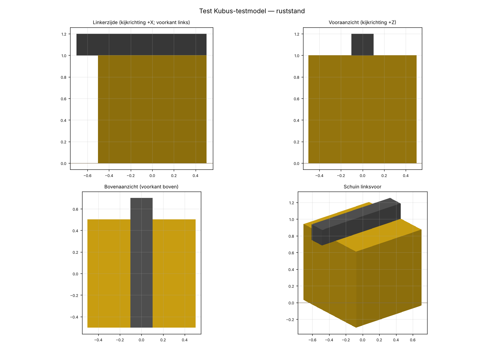

# Rapport OV_TEST: Test Kubus-testmodel

- Machinetype: overig  |  detailniveau: volledig  |  rig: —  |  categorie: Overig
- Bron: —  |  licentie: Eigen werk, gegenereerd door tools/maak_testmodel.py; vrij te gebruiken en herdistribueren  |  formaat: GLB (mm, Z-up)
- Afmetingen (m): lengte 1.200, breedte 1.000, hoogte 1.200  (bbox [-0.5, 0.0, -0.7] … [0.5, 1.2, 0.5], ruststand)
- Polygonen: 24
- Bibliotheek-CSV: `OV_TEST/model.glb;0;1;`


## Voorbeeld



## Controle

| Groep | Status | Bevinding |
|---|---|---|
| manifest | OK | alle sjabloonsleutels aanwezig |
| manifest | OK | bibliotheek_csv: OV_TEST/model.glb;0;1; |
| hiërarchie | OK | 3 nodes, parent-child gelijk aan manifest |
| bevroren | OK | alle nodes schaal 1; rotatie alleen op gerichte cilinderhelften |
| namen | OK | alle namen uniek |
| afmetingen | OK | bbox breedte(X) 1.000 × hoogte(Y) 1.200 × lengte(Z) 1.200 m |
| afmetingen | OK | manifest-afmetingen wijken max 0.000 m af |
| nulpunt | OK | grond van OV_TEST_Voet: Y = 0.0000 m |
| nulpunt | OK | midden OV_TEST_Voet op X,Z = [0.0, 0.0] |
| voorkant | WAARSCHUWING | voorkant niet automatisch te bepalen (geen Giek/Bak/Voorwagen) |
| polygonen | OK | 24 driehoeken (doel ≤ 50000) |
| normalen | OK | alle primitieven hebben eenheidsnormalen, consistent met de winding |
| faces | OK | alle meshes gesloten (geen open randen) |
| texturen | OK | geen texturen gebruikt |
| pivot | OK | OV_TEST_Arm: draaipunt [0.0, 1.0, 0.5] (= manifest, op de eigen geometrie) |
| extras | OK | 1 joints met draaias/min_hoek_graden/max_hoek_graden in node-extras = manifest |
| joint-test | OK | 1 node-paren raken elkaar in ruststand (pennen, bokken, cilinders); doorsnijding = nieuw contact > 1 cm of bestaand contact > 5 cm dieper |
| joint-test | OK | OV_TEST_Arm: geen nieuwe doorsnijding op min 0 / max 90; positief = heffen |
| joint-test | OK | geen vervorming mogelijk: alle nodes rigide (schaal 1, geen skinning) |
| animatie | OK | test_animatie.glb: per joint 0 → min → max → 0, cilinders mee gericht (4 s) |

## Hiërarchie

```
- OV_TEST  (oorsprong [0.0, 0.0, 0.0])
  - OV_TEST_Voet  (oorsprong [0.0, 0.0, 0.0])
    - OV_TEST_Arm  (oorsprong [0.0, 1.0, 0.5])  [0..90°] lokaal X (Godot: X); positieve hoek = heffen
```

## Joints: begin- en eindstand

| Joint | As | As glTF | Positief (gemeten) | Min | Zwaartepunt bij min | Max | Zwaartepunt bij max | Doorsnijding |
|---|---|---|---|---|---|---|---|---|
| OV_TEST_Arm | X | [1, 0, 0] | heffen | 0° | [0.0, 1.1, -0.1] | 90° | [0.0, 1.6, 0.6] | geen |

Testanimatie: `test_animatie.glb` (animatie `Jointtest`, cilinders mee gericht).

## Polygonen per node

| Node | Driehoeken |
|---|---|
| OV_TEST_Voet | 12 |
| OV_TEST_Arm | 12 |

## Vergelijking met referentie

| Bestand | Afm X×Y×Z (m) | Min | Max | Voorkant | Wortel |
|---|---|---|---|---|---|
| A40G.glb | [3.59, 4.196, 11.406] | [-1.795, -0.015, -4.52] | [1.795, 4.181, 6.886] | -Z (Voorwagen) | ['A40G'] |
| Cat336E_LongReach.glb | [4.08, 8.745, 19.112] | [-2.04, -0.008, -15.526] | [2.04, 8.737, 3.586] | -Z (Giek) | ['Cat336E'] |

## Afwijkingen van de conventie

- bron in auto-0.001: geschaald met factor 0.001 naar meter
- bron-oriëntatie up +Z, voorkant +X: gedraaid naar Y-up, voorkant -Z
- midden onderwagen op de grond lag in de bron op [1.5, 0.25, -3.0] m (na eenheid/as-conversie): naar 0 verschoven
- spiegeling: glTF is rechtshandig, Unreal linkshandig; de importer spiegelt één as. Niet in het model gecorrigeerd

## Aannames

- bron-eenheid automatisch bepaald: grootste maat 1200.0 eenheden -> factor 0.001
- joint-assen in Blender-notatie zoals extras.draaias in de referentie (X = dwars, Z = verticaal); positief = heffen/uit/open (X) en naar links (Z)
- joint OV_TEST_Arm: limieten geschat (0..90)

## Openstaande punten

- rig ontbreekt in 4DVis voor machinetype 'overig': keten en joints zitten in het model en dit manifest
- sleutel 'min_hoek_graden' komt niet in de referentie voor (die kent alleen max_hoek_graden / max_knik_graden en cilinder-penafstanden); naar hetzelfde patroon toegevoegd, bevestigen in 4DVis
